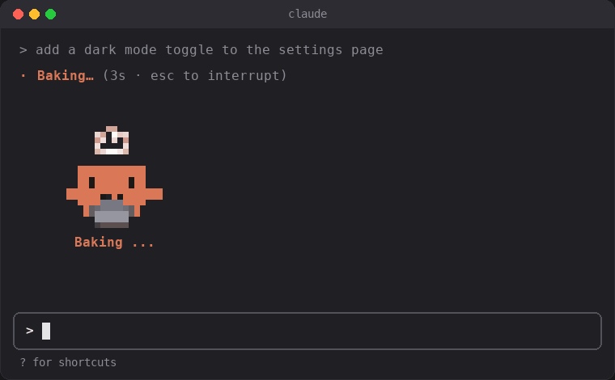
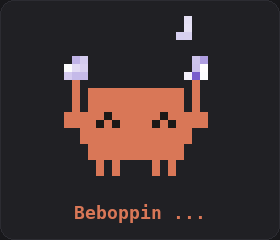
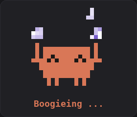
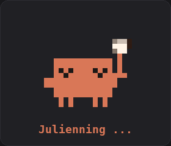
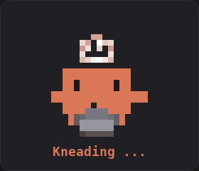
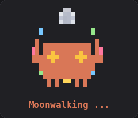
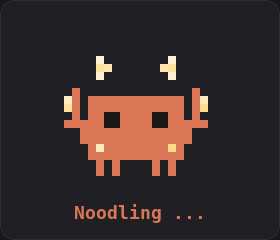
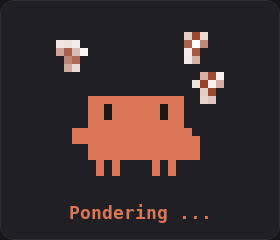
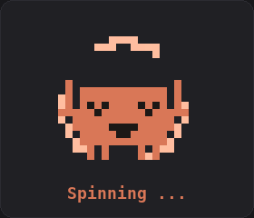
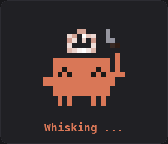

# dancing-pet

A Claude Code mod that puts a little pixel-art Claude pet above your prompt while Claude is working on a response. The pet acts out the current spinner word (Baking, Julienning, Whirlpooling, ...), with the word shown underneath it, and disappears as soon as the turn ends.

<p align="center">
  
</p>

It includes 187 animated poses, one per spinner word, drawn with colored half-block characters, so it works in any terminal with true-color support.

## Meet the pets

A different pet for every spinner word. Here are a few of them:

<table>
  <tr>
    <td align="center"></td>
    <td align="center"></td>
    <td align="center"></td>
  </tr>
  <tr>
    <td align="center"></td>
    <td align="center"></td>
    <td align="center"></td>
  </tr>
  <tr>
    <td align="center"></td>
    <td align="center"></td>
    <td align="center"></td>
  </tr>
</table>

## Install

At the prompt of a Claude Code terminal session:

```
/plugin install dancing-pet --marketplace hussein-001/dancing-pet
```

Answer `y` to add the marketplace, then press Enter to pick the user scope. The pet appears from your next prompt on.

From a shell:

```
claude plugin install dancing-pet --marketplace hussein-001/dancing-pet
```

In the desktop app, where `/plugin` does not run: click + next to the prompt box, then Plugins, Add marketplace with `hussein-001/dancing-pet`, then Add plugin. The pet draws in terminal sessions only.

## How it works

- `hooks/register.tsx` draws the pet in the band above the prompt while a turn is running, and animates it about 11 frames a second.
- `hooks/stickers*.ts` hold the animation frames, generated by `convert.py` from a folder of 512x512 GIF stickers (`python convert.py <gif folder> hooks/stickers.ts`, needs Pillow).
- `render_gifs.py` renders the GIFs in this README from those same frames (`python render_gifs.py .`, macOS for the Menlo font).

## Turning it off and on

```
/pet          switch the pet off or on
/pet off      hide it
/pet on       bring it back
```

It works while Claude is still responding, and your choice is remembered in new sessions.

## Updating

To get the newest release:

```
claude plugin update dancing-pet
```

Then restart Claude Code. Every version is listed on the [Releases](https://github.com/hussein-001/dancing-pet/releases) page, and what changed is in [CHANGELOG.md](CHANGELOG.md).

## Releasing a new version

Versions follow [Semantic Versioning](https://semver.org/): a patch (0.1.1) for fixes, a minor (0.2.0) for new pets or features, a major (1.0.0) for changes that break how the mod is used.

1. Set the new `version` in `.claude-plugin/plugin.json`. Installs only see an update when this number goes up.
2. In `CHANGELOG.md`, move the entries under `[Unreleased]` into a new `## [x.y.z] - YYYY-MM-DD` section, and add its link at the bottom.
3. Commit, then tag the release. `claude plugin tag` checks the manifest and names the tag `dancing-pet--vx.y.z`:
   ```
   claude plugin tag . -m "dancing-pet v%s"
   ```
   With GitHub Desktop, create the tag there instead (right-click the commit, Create Tag…), since Desktop only pushes tags it made itself.
4. Push the commit and the tag. The [Release workflow](.github/workflows/release.yml) checks that the tag matches `plugin.json`, then publishes a GitHub release with that version's changelog section as its notes.

## Notes

The pet artwork is a fan-made pixel version of the Claude Code mascot. This is not an official Anthropic project.

## License

MIT, see [LICENSE](LICENSE).
